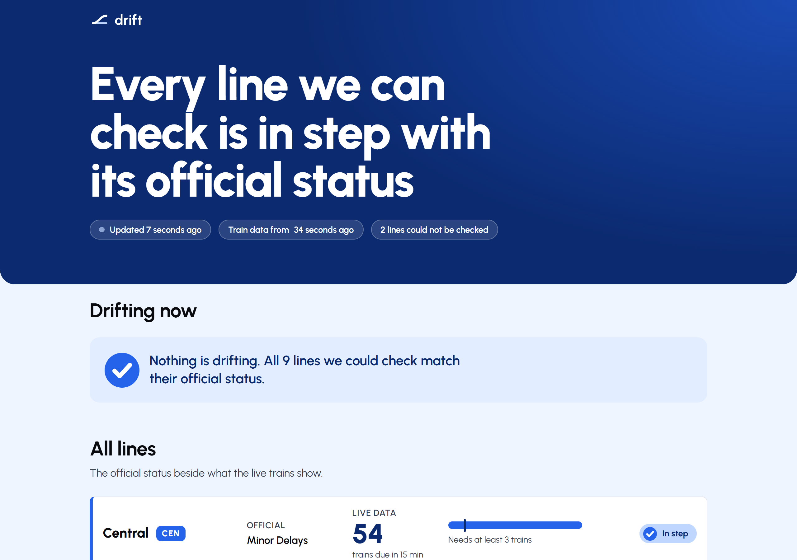
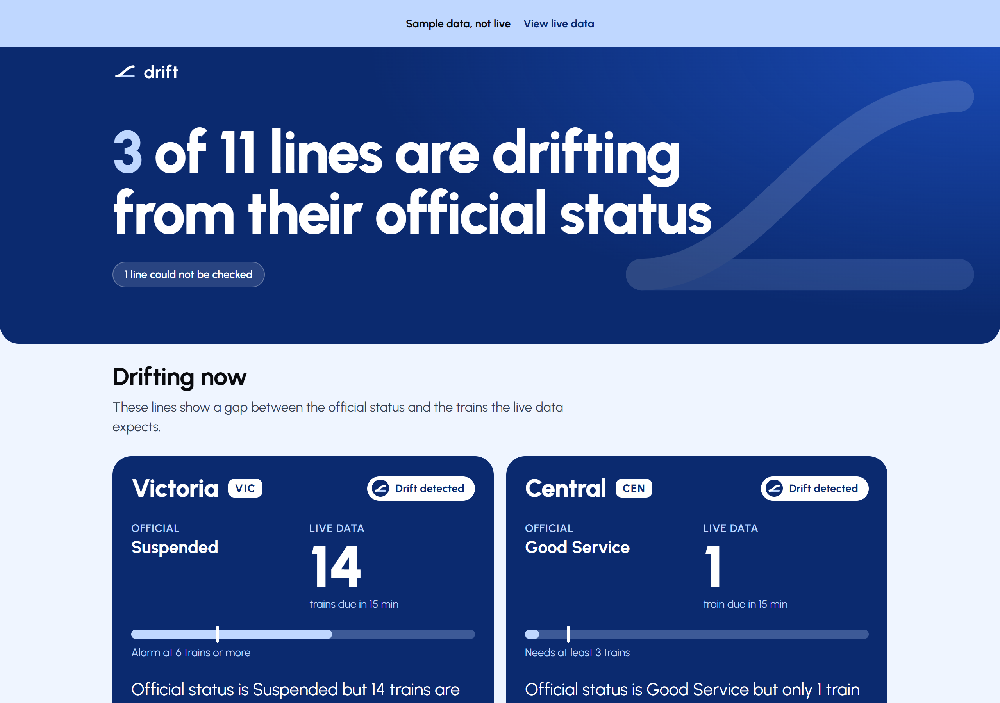
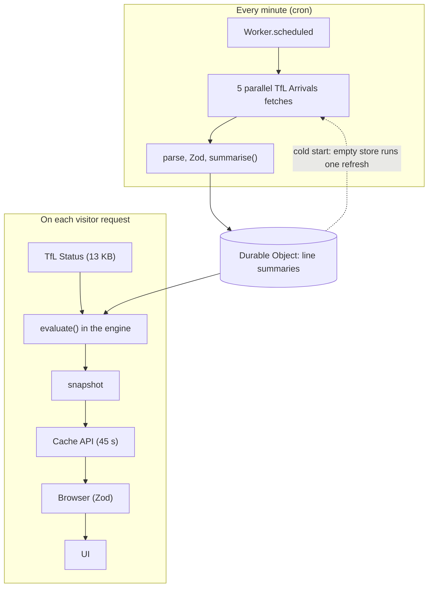

<picture>
  <source media="(prefers-color-scheme: dark)" srcset="brand/logo-white.svg">
  
</picture>

**Where the official status and the real network drift apart.**

Drift is a live page that checks whether Transport for London's official Tube line
status matches what the trains are actually doing. TfL says a line has Good Service,
Drift looks at the live train predictions, and if the two disagree it says so, with
the rule that fired, a plain reason and how confident it is.

| Live, on a phone                                      | Live, on a desktop                                       |
| ----------------------------------------------------- | -------------------------------------------------------- |
|  |  |

The images above are the real live site, with the network healthy. The mismatch design
is shown in sample mode:

| Sample mode, 375px                                            | Sample mode, 1280px                                             |
| ------------------------------------------------------------- | --------------------------------------------------------------- |
|  |  |

The sample images come from `/?sample=1`: open `/?sample=1` to see the mismatch design built from
fixture data by the real engine, under a persistent "Sample data, not live" banner. It
only turns on for that exact query parameter and makes no network request. No real
mismatch has appeared in the hours Drift has been watched (see
[How it was verified](#how-it-was-verified)), so this is how the design is reviewed.

## Why

An official status is a statement, not a measurement. Drift compares the statement
with the evidence: how many trains are due soon, in which directions, and how far
apart they are. A false alarm is worse than a missed one, so whenever the evidence is
thin, missing or ambiguous, Drift says "not enough data" rather than guessing.

## How it works



One Cloudflare Worker serves the web app and the API, so there is one deploy, one
URL and no CORS. The interesting constraint is TfL's arrivals feed: 3 to 4 MB, and
about 25 to 45 ms of CPU just to parse, against a documented free tier limit of 10 ms.
So the heavy parsing happens off the request path, inside a Durable Object driven by
a once a minute cron trigger, which reduces each line to a tiny summary. The request
handler only reads the 13 KB status feed and those summaries. The full reasoning, with
the measurements, is in [docs/ARCHITECTURE.md](docs/ARCHITECTURE.md).

Resilience: every upstream call has a timeout, retries with exponential backoff and
jitter (honouring `Retry-After`), concurrent requests share one in flight build, a
short cache keeps TfL traffic independent of visitor count, and if TfL is down the
Worker serves the last good snapshot marked stale, or a typed 503 if there is none.
It never returns a bare 500.

Cold start: if the store holds no line summaries, as on empty storage, the first
request runs one refresh itself instead of waiting for the next cron tick. Concurrent
requests share that refresh, it is capped at 7 seconds, and if it fails the page still
gets a valid snapshot with those lines marked "not enough data". If TfL's status feed is
down and nothing has ever been stored, the Worker still answers with the typed 503.

One live incident is not explained. Shortly after a deploy, the site showed "Live data is
unavailable" with no earlier snapshot. By the time it was investigated, the API was
healthy and the logs showed no errors, so the cause was **not proven**. The cold start
gap above is the likeliest explanation and is now closed, but that is an inference, not a
finding.

## The rules

All thresholds are named constants in `packages/engine/src/config.ts`, each with its
origin. Every rule, with examples, is in [docs/RULES.md](docs/RULES.md).

| Rule                    | Fires when                                                                                            |
| ----------------------- | ----------------------------------------------------------------------------------------------------- |
| Quiet while good        | Status is Good Service but fewer than 3 trains are due in 15 minutes, or one direction has none       |
| Flowing while suspended | Status is Suspended, Closed or Not Running yet 6 or more trains are due                               |
| Wide gaps               | Good Service or Minor Delays, but the typical gap between trains at a platform is 15 minutes or more  |
| Long waits              | Good Service or Minor Delays, but 30 percent or more of platforms wait 20 minutes or more for a train |
| No trains               | Good Service, a fresh feed with no trains for the line, in service hours, while other lines run       |

Wide gaps and long waits work per platform (the next train wait and the gap after it),
not on a whole line count, so a line losing part of its service cannot hide behind busy
platforms. Wide gaps used to be unreachable on live data and was fixed after review;
the history is in the [changelog](CHANGELOG.md).

Partial closures, planned works, Severe Delays and missing data never produce a
mismatch. They resolve to "unknown". A network wide quiet guard stops a feed fault or
the end of service hours from looking like every line failing at once.

## Run it locally

Requires Node 22 and pnpm.

```
pnpm install
cp apps/worker/.dev.vars.example apps/worker/.dev.vars   # then add your own TfL key
pnpm build
pnpm --filter @drift/worker dev                          # http://127.0.0.1:8787
```

Get a free key at the [TfL API portal](https://api-portal.tfl.gov.uk/). The key lives
only in the gitignored `.dev.vars` file, never in the repository. To trigger the
once a minute refresh by hand while developing, open
`http://127.0.0.1:8787/__scheduled?cron=*+*+*+*+*`.

## Scripts

| Command              | What it does                                            |
| -------------------- | ------------------------------------------------------- |
| `pnpm test`          | Run every test                                          |
| `pnpm test:coverage` | Run tests with the enforced coverage thresholds         |
| `pnpm typecheck`     | Type check every package                                |
| `pnpm lint`          | ESLint with strict typescript-eslint                    |
| `pnpm format:check`  | Prettier check                                          |
| `pnpm build`         | Build the web app, then the Worker bundle               |
| `pnpm deploy`        | Build and deploy with wrangler (needs `wrangler login`) |
| `pnpm brand`         | Regenerate the logo, favicons and social image from SVG |

The brand script (`scripts/brand.mjs`) writes the SVG sources to `brand/`, outlining
the wordmark from the real Urbanist glyphs so no SVG depends on an installed font,
then renders the PNG, ICO and Open Graph files into `apps/web/public/`.

## Testing

351 tests across 18 files, run on every push. Coverage overall is 96 percent of
statements and 92 percent of branches, with thresholds enforced in CI (engine, shared
and Worker at 90 percent or more).

- **Engine:** table driven cases with boundary values on both sides of every
  threshold, hand built edge cases (empty, malformed, partial, stale), and tests on
  fixtures captured from the real TfL API.
- **Worker:** mocked `fetch` covering success, schema failure, timeout, 429 with
  `Retry-After`, 5xx then recovery, outage with and without a last good snapshot, cache
  hit, request coalescing, and proof that the key never appears in any log or
  response.
- **Web:** every state (loading, in step, mismatches, partial data, stale, offline,
  hard error with retry) with an automated accessibility check on each, plus a test
  that computes WCAG contrast for the actual palette tokens.

CI also runs typecheck, lint, format check, the build and a gitleaks secret scan.
A local pre-commit hook runs lint and format on staged files.

## Deployment

```
pnpm deploy
printf '%s' "$TFL_APP_KEY" | pnpm --filter @drift/worker exec wrangler secret put TFL_APP_KEY
```

The first deploy creates the Worker, its SQLite backed Durable Object and the cron
trigger. Cloudflare can take around ten minutes to start a new cron trigger.

## How it was verified

See [docs/VERIFICATION.md](docs/VERIFICATION.md) for the dated record. In short:

- The `official` column was compared with TfL's own public status page at several
  times and matched every time.
- Train counts were recomputed independently from TfL's raw arrivals feed with
  separate code and agreed with Drift's live numbers to within a few trains on lines
  carrying 11 to 73.
- A background sampler recorded every line every ten minutes for the whole session, with
  four spaced raw snapshots kept for the headway rule. No healthy line came close to a
  threshold: the fewest trains due in 15 minutes was 9 (Circle) against a floor of 3, the
  quietest direction on any line still had 5 trains, and the slowest typical headway was
  9.8 minutes (Circle) against a bar of 15.
- The outage behaviour was exercised against the real TfL API on a local Worker with
  real persisted storage: success, a stale fallback when TfL rejected the key, and a
  typed 503 with empty storage. The key appeared in no log or response.
- Lighthouse on the deployed site, mobile profile, median of three runs:
  **Performance 98, Accessibility 100, Best Practices 100, SEO 100** (after the 2026-11-08 redesign).
- No horizontal scroll at 320, 375, 768 or 1280 pixels.

Size: the initial JavaScript is about 115 KB gzipped (React is 67 KB of that), with a
further 41 KB of animation code that loads after first paint. Total transfer on first
load is about 190 KB including the self hosted font.

## Deviations from the plan

The plan sent before building described a cron split by line and KV storage. Three
things changed once the real numbers were in.

- **KV became a Durable Object.** Workers KV allows 1,000 writes a day on the free
  plan, and the refresh writes every minute, so KV could not hold the state.
- **One cron trigger with five parallel fetches replaced the per line cron split.** A
  deployed measurement showed the Durable Object has far more CPU headroom than a plain
  handler, so one trigger now drives five parallel TfL fetches inside it. That is
  simpler, and one failing group still leaves the other lines fresh.
- **`domMax` replaced `domAnimation`.** The brief asks for both a small bundle and a
  layout animation when lines reorder, but layout animation only exists in `domMax`.
  It loads lazily after first paint, so the initial bundle stays small.

## Not finished

Said plainly, so nothing here is a surprise.

- **The time of day baseline is not built.** The rules compare against fixed
  thresholds, not against what is normal for a platform at that hour. A platform that
  loses every train drops out of the feed and cannot be seen, so a line losing whole
  platforms is caught only when enough others show long waits or the line goes silent.
  This is the next piece of work.
- **No real mismatch has been observed.** In the hours Drift was watched the network
  was healthy, so every verdict was "in step" or "unknown". The five rules are proven
  by tests and fixtures, not by a real disruption. Rule 2 in particular (flowing while
  suspended) has never been seen against a real suspension.
- **Thresholds are calibrated on one day**, a Sunday from morning to early afternoon.
  Weekday peak and overnight behaviour have not been measured, and the numbers may need
  adjusting.
- **Severe Delays always resolves to unknown.** Delayed trains still run, so train
  counts cannot contradict it. A deliberate cut, not an oversight.
- **Tube only.** The Elizabeth line would fit the CPU budget but its train spacing is
  too irregular for the wide gaps rule to be trustworthy. DLR has no vehicle ids in its
  feed, so trains cannot be counted.
- **No dark theme.**
- **I did not run the outage test on production.** Simulating TfL being down would
  mean overwriting the live secret with an invalid one, and I chose not to do that on the
  live site. Instead I exercised the same behaviour against the real TfL API on a local
  Worker with real persisted storage (success, stale fallback, typed 503), and it is
  covered by unit tests. That local run is the evidence.
- **A forced upstream timeout is covered by unit tests.** I have not triggered one
  against a local Worker.

## Known risk

An uncached `/api/snapshot` costs 8 to 19 ms of CPU, above the documented 10 ms free
tier figure. Cloudflare did not enforce that limit in testing, but it could. The
mitigation is in the design: the heavy arrivals parsing runs in the Durable Object off
the request path, a 45 second cache means most requests cost 1 to 2 ms, and concurrent
requests share one build. If the limit were ever enforced, the first step would be to
move the status fetch into the cron refresh too, so the request path only reads stored
data.

## What I would do next

- Build the time of day baseline per platform, then compare current trains per platform
  with it.
- Watch it through a weekday peak, an overnight period and a real disruption, then
  recalibrate the thresholds and confirm the flowing while suspended rule.
- Add a dark theme.
- Add the Elizabeth line and the DLR if a trustworthy rule for their irregular spacing
  and missing vehicle ids can be found.
- Trigger a forced upstream timeout and an outage against a local Worker as scripted
  checks, not only unit tests.
- Record a short history of verdicts, so a mismatch can be shown with how long it lasted.

## Time spent

8 hours in total. The split below is approximate.

- Planning and API discovery: about 1 hour
- Foundation, tooling and CI: about 1 hour
- Engine and Worker: about 2 hours
- Web app and brand: about 1.5 hours
- Redesign and outage fix: about 1 hour
- Verification, docs and packaging: about 1.5 hours

## Phone check

Checked on a Samsung S23 5G in Chrome, on MTN mobile data. Sample mode at `/?sample=1`
showed 3 of 11 lines drifting with all three mismatch cards, the full line list and the
three footer links.

## A note on the commit history

I removed the AI co-author trailer lines from the commit messages with a one time
history rewrite and force push. Authors, dates and file contents are unchanged. How AI
was used is documented in [CLAUDE.md](CLAUDE.md) and in [docs/prompts](docs/prompts).

## Licence and attribution

MIT, see [LICENSE](LICENSE). An independent project using TfL open data. Powered by
TfL Open Data. Not affiliated with Transport for London. TfL data is used under the
[TfL open data licence](https://tfl.gov.uk/corporate/terms-and-conditions/transport-data-service).
The Urbanist typeface is used under the SIL Open Font Licence.
